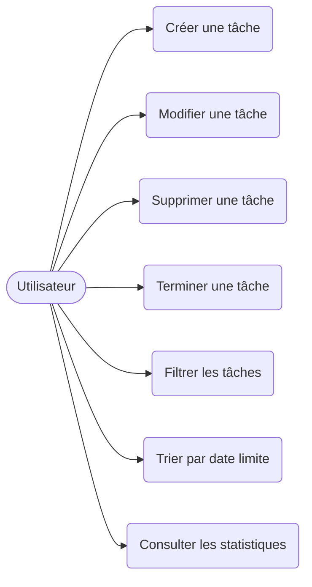
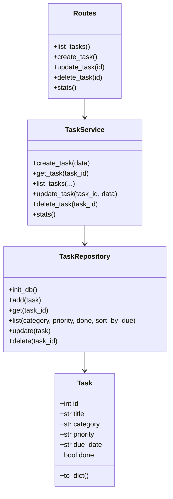

# Diagrammes UML

GitHub affiche automatiquement les diagrammes Mermaid ci-dessous.

## Diagramme de cas d'utilisation



## Diagramme de classes



## Diagramme de séquence : création d'une tâche

```mermaid
sequenceDiagram
    actor U as Utilisateur
    participant UI as Interface (app.js)
    participant R as Routes (Flask)
    participant S as TaskService
    participant P as TaskRepository
    participant DB as SQLite

    U->>UI: Remplit le formulaire
    UI->>R: POST /tasks (JSON)
    R->>S: create_task(data)
    S->>S: Valide titre, priorité, date
    S->>P: add(task)
    P->>DB: INSERT INTO tasks
    DB-->>P: id
    P-->>S: task
    S-->>R: task
    R-->>UI: 201 + JSON
    UI-->>U: Affiche la nouvelle tâche